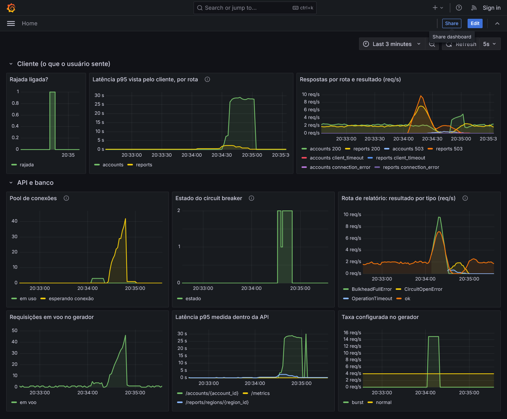
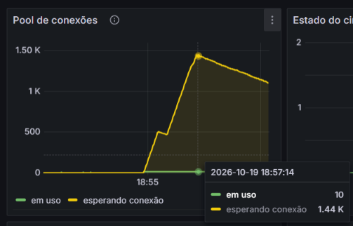
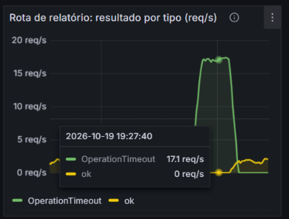
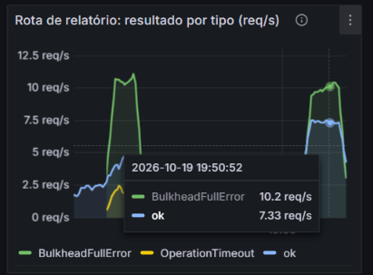

# Postgres Resilience Lab

Um laboratório para ver um banco de dados colapsar sob carga e resolver o problema com timeout, bulkhead e circuit breaker, implementados do zero em Python.

O banco é fraco de propósito, a API depende dele e um gerador de carga tem um botão que derruba tudo. Cada proteção foi escrita depois de ver, no Grafana, o problema que ela resolve.



> Quer tentar resolver você mesmo? A branch [`challenge`](../../tree/challenge) tem o mesmo ambiente com a camada de resiliência vazia, os testes e um roteiro.

## O cenário

- **Postgres** limitado a 0,5 CPU e 256 MB, com 1 milhão de transações e sem índice na coluna usada pelo relatório. Cada relatório lê a tabela inteira.
- **API** em FastAPI com duas rotas que dividem um pool de 10 conexões:
  - `/accounts/{id}`: consulta leve, deixada sem proteção para comparação;
  - `/reports/regions/{id}`: consulta pesada, protegida pela camada de resiliência.
- **Gerador de carga** com tráfego normal (4 req/s) e uma rajada de 15 req/s que liga e desliga num painel web.
- **Prometheus e Grafana** com latência por rota, uso do pool, estado do circuito e o resultado de cada chamada ao relatório.

```
                       ┌──────────── API (FastAPI) ─────────────┐
gerador de carga ──►   │ /accounts/{id}        ─────────────────┼──► pool (10 conexões) ──► Postgres
 normal: sempre on     │ /reports/regions/{id} ─► run_protected ┼──►                        (0,5 CPU, 256 MB)
 rajada: on/off        └────────────────────────────────────────┘
```

## O experimento

### Sem proteção

A rajada manda ~19 req/s para um banco que entrega ~5 relatórios/s. A fila de espera por conexão cresce em linha reta até passar de mil, e a rota leve morre junto, porque espera na mesma fila. Depois que a rajada para, o sistema ainda leva minutos para voltar: a API continua processando requisições que os clientes já abandonaram.



### Timeout

O timeout de 1 s cobre a espera pela conexão e a query. A fila fica limitada e a recuperação passa a ser imediata. Mas, com 10 consultas dividindo meia CPU, cada uma leva ~1,2 s e é cancelada antes de terminar: zero relatórios bem-sucedidos durante a rajada. Aumentar o prazo para 3 s só aumenta a fila.



### Bulkhead

Um semáforo limita os relatórios simultâneos e recusa em até 50 ms quem não consegue vaga. Isso reserva conexões para a rota leve e reduz a disputa por CPU. Com 6 vagas ainda havia timeouts. Com 3, dimensionado a partir da capacidade medida, os timeouts sumiram e os relatórios bem-sucedidos subiram de ~4 para ~7 por segundo.



### Circuit breaker

Abre depois de 5 falhas seguidas, recusa sem tocar no banco e, depois de 5 s, deixa passar uma única chamada de prova. Também trata prova cancelada e ignora resultados de chamadas que começaram num estado anterior.

Na rajada, ele não abre: o banco está cheio, não doente, e isso é papel do bulkhead. Com o banco desligado, abre em segundos e fecha sozinho quando o banco volta.

### Resumo

| | Sem proteção | Com as três peças |
|---|---|---|
| Fila de espera no pool | passou de 1.400 e continuava subindo | zero |
| Rota leve durante a rajada | parou de responder | continuou rápida |
| Relatórios bem-sucedidos | ~5/s, para clientes que já tinham desistido | ~7/s |
| Recuperação depois da rajada | minutos | imediata |
| Banco desligado | rota pendurada até o timeout do cliente | falha em milissegundos, volta sozinha |

## A implementação

Fica em [`app/resilience/`](app/resilience/):

| Arquivo | O que faz |
|---|---|
| [`timeout.py`](app/resilience/timeout.py) | `asyncio.wait_for` com tradução para `OperationTimeout` |
| [`bulkhead.py`](app/resilience/bulkhead.py) | semáforo com espera máxima na entrada |
| [`circuit_breaker.py`](app/resilience/circuit_breaker.py) | máquina de estados com prova única, cancelamento e gerações |
| [`pipeline.py`](app/resilience/pipeline.py) | a composição: bulkhead, breaker, timeout e operação |

A ordem da composição é uma decisão de projeto. O bulkhead fica por fora para que uma recusa por excesso de carga não conte como falha do banco. O timeout fica por dentro para que um prazo estourado chegue ao breaker como falha comum, e não como cancelamento.

Os 31 testes em [`tests/`](tests/) especificam cada peça. Os do circuit breaker são organizados em seis níveis, do básico até concorrência e cancelamento.

## Como rodar

Pré-requisitos: Docker e, para os testes, Python 3.11 ou mais novo.

```bash
cp .env.example .env
docker compose up -d --build
```

Na primeira subida, o Postgres leva uns 30 s para gerar os dados.

| O quê | Onde |
|---|---|
| Painel do gerador de carga | http://localhost:8001 |
| Grafana (sem login) | http://localhost:3000 |
| API e Swagger | http://localhost:8000/docs |

Para reproduzir o experimento: ligue a rajada no painel do gerador, observe o Grafana por um minuto e desligue. Para testar a queda do banco, use `docker compose stop postgres` e depois `docker compose start postgres`.

Testes:

```bash
python -m pip install -r requirements-dev.txt
python -m pytest
```

Os parâmetros (CPU e memória do banco, tamanho do pool, timeout, vagas do bulkhead e limites do breaker) ficam no `.env`. Depois de mudar, recrie o serviço com `docker compose up -d <serviço>`.

## Estrutura

```
app/            API, acesso ao banco, métricas
app/resilience/ timeout, bulkhead, circuit breaker e composição
loadgen/        gerador de carga com painel liga/desliga
database/init/  schema e dados
observability/  Prometheus e dashboard do Grafana
tests/          especificação das três peças
docs/           roteiro de estudo e imagens
```

## Branches

- **`solution`**: o projeto completo, com a implementação.
- **`challenge`**: o mesmo ambiente com a camada de resiliência vazia, para quem quiser resolver do seu jeito.

## Licença

[MIT](LICENSE)
